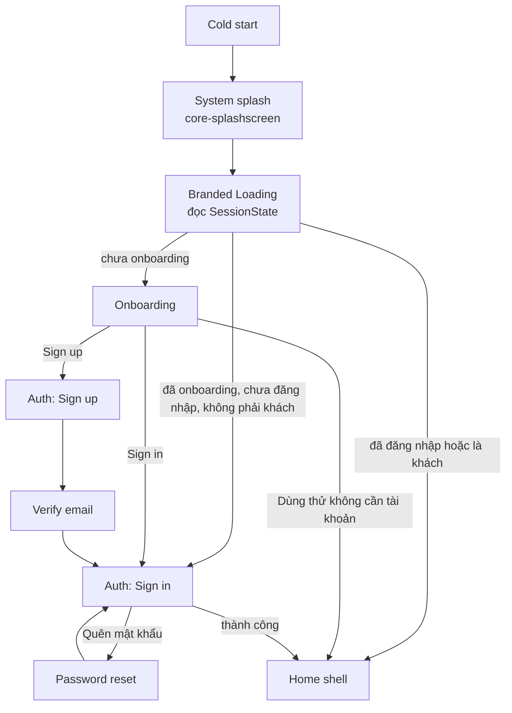

# Luồng màn hình

Thiết kế tham khảo: bộ mockup Stitch "Serene Ocean Journal" (splash, onboarding, app shell, ba biến thể Home). Mockup là **tham khảo, không phải spec**. Những điểm đã điều chỉnh so với mockup được ghi ở [design-system.md](design-system.md#10-điều-chỉnh-so-với-mockup-stitch) và [ADR-0005](adr/0005-stitch-mockups-as-reference.md).

## 1. Khởi động

| Màn hình | Destination | Back stack sau khi rời màn |
|---|---|---|
| Loading | `SplashDestination` | Bị xoá (`popUpTo(inclusive = true)`) |
| Onboarding | `OnboardingDestination` | Bị xoá khi người dùng chọn một hướng đi |
| Auth | `AuthGraph { SignIn, SignUp, VerifyEmail, ForgotPassword, ResetPassword }` | Cả graph bị xoá khi đăng nhập thành công |
| Home shell | `MainGraph` | Gốc của app |

- Cờ "đã xem onboarding" được ghi khi người dùng **chọn** một hướng đi. Nếu thoát giữa chừng thì lần sau mở lại Onboarding.
- Khách có thể mở Auth bất cứ lúc nào từ top bar hoặc từ các card mời đăng ký. Đăng nhập xong thì quay về đúng tab đang mở.

## 2. Loading

- Nền và icon trùng với system splash. Hiển thị mascot, logo, slogan và indicator ngọc trai.
- Thời gian hiển thị theo [ADR-0003](adr/0003-splash-and-branded-loading.md): **tối thiểu 3 giây** (`MIN_SPLASH_MILLIS`), và chờ thêm nếu `SessionState` chưa sẵn sàng. Hai việc chạy song song, cái nào xong sau thì quyết định lúc chuyển màn.
- Màn hình tiếp theo được chọn **chỉ từ dữ liệu local**: cờ onboarding, chế độ khách và user đã cache. Splash không gọi mạng, nên mở app khi offline vẫn vào thẳng Home.
- Mất mạng: **không chặn** người dùng. Phiên được kiểm tra với backend ở request cần đăng nhập đầu tiên. Thanh "Prototype test" và các ghi chú kỹ thuật trong mockup **không** đưa vào app.

## 3. Onboarding

- Pager gồm 3 slide giới thiệu và 1 trang chọn cách bắt đầu.
- Slide 1–3: mascot, greeting, kicker (nhãn nhỏ viết hoa), tiêu đề, mô tả có đoạn in đậm, 2–3 tag. Mỗi slide có nút "Tiếp theo".
- Trang 4: **Đăng ký tài khoản mới** (primary), **Đã có tài khoản? Đăng nhập** (secondary), **Dùng thử không cần tài khoản** (text button).
- Nút "Bỏ qua" chuyển tới trang 4, và bị ẩn khi đang ở trang 4.
- Trên màn ≥600dp: mascot đặt bên trái, card bên phải.

## 4. Auth

| Màn | Thành phần | API |
|---|---|---|
| Sign in | Email, mật khẩu (nút hiện/ẩn), nút Đăng nhập, "Tiếp tục với Google" (đặt sau feature flag), link Quên mật khẩu, link Đăng ký | `auth/login` |
| Sign up | Họ tên, email, số điện thoại (tùy chọn), mật khẩu, xác nhận mật khẩu | `auth/register` → `challengeId` |
| Verify email | Ô OTP 6 số, nút Gửi lại có đếm ngược | `auth/verify-email`, `auth/resend-verification` |
| Forgot password | Email → OTP → mật khẩu mới (3 bước trên cùng một màn) | `password-reset/otp`, `/verify`, `/confirm` |

Mã lỗi backend được map sang chuỗi theo [api-integration.md](api-integration.md#10-bảng-mã-lỗi).

Quy tắc chung của các màn Auth, nhằm giảm tải cho backend:

- Mọi field được kiểm tra trên máy trước khi gửi. Form sai không tạo request nào.
- Nút gửi bị khoá khi đang chờ phản hồi, nên bấm nhiều lần cũng chỉ có một request.
- Ô OTP chỉ nhận 6 chữ số và tự gửi khi đủ 6 số. Nút "Gửi lại mã" có đếm ngược theo `cooldownSeconds` (mặc định 60 giây).
- Đăng nhập khi email chưa xác thực: app tự gửi lại OTP rồi mở màn Verify email.
- Xác thực email hoặc đặt lại mật khẩu xong: quay về Sign in với email điền sẵn và thông báo, back stack được xoá.
- "Dùng thử không cần tài khoản" chỉ lưu cờ khách trên máy, không gọi backend.
- Đăng xuất xoá session trên máy ngay (chạy được khi offline), rồi gọi `logout` ở nền nếu có mạng.

## 5. Home shell

### 5.1 Khung chung

| Thành phần | Spec |
|---|---|
| Top bar | Avatar, lời chào theo buổi (5–11 giờ sáng, 12–17 giờ chiều, còn lại tối, giống web), tên người dùng, nút tìm kiếm, nút thông báo. Khách thấy "Chào bạn!" và nút "Đăng nhập" thay cho chuông |
| Bottom bar | 5 tab: **Trang chủ · Khám phá · Luyện tập · Từ vựng · Cá nhân** trên cửa sổ dưới 600dp |
| Navigation rail | Cửa sổ ≥600dp (`WindowWidth` trong `core/ui`). Nút ☰ nằm đầu top bar (icon trơn, căn thẳng cột rail), lời chào ngay bên phải, avatar chuyển xuống chân rail. Rail thu gọn rộng 88dp: icon kèm nhãn bên dưới cho Trang chủ, Khám phá, Luyện tập, Từ vựng. Bấm ☰ để mở rộng 248dp: nhãn nằm bên phải icon, chân rail hiện tên và email. 600–840dp: rail mở rộng nổi trên nội dung, nền đặc, kèm lớp mờ; chạm ra ngoài hoặc Back để thu lại. ≥840dp: rail mở rộng đẩy nội dung. Nội dung rộng tối đa 840dp |
| Nội dung | `MainDestination` trong root graph chứa `Scaffold`; các tab nằm trong graph lồng `MainGraph`, mỗi tab một destination. Top bar và bottom bar cố định khi đổi tab |
| Tab mặc định | Đã đăng nhập: **Trang chủ**. Khách: **Khám phá** |
| Đổi tab | Mỗi tab giữ state riêng (`saveState` / `restoreState`). Back quay về tab mặc định rồi mới thoát app |
| Offline | Biến thể và thông tin người dùng lấy từ `SessionState` trên máy, không cần mạng |

Tìm kiếm, thông báo, bộ lọc nâng cao, bấm vào trung tâm, đổi ảnh đại diện và xóa tài khoản hiện snackbar "Tính năng đang được phát triển" (`rememberComingSoonAction`) cho tới khi có API.

### 5.2 Ba biến thể của tab Trang chủ

Biến thể được suy ra từ `SessionState` (qua `Viewer` trong `MainViewModel`), không phải từ một cờ cứng:

| Biến thể | Điều kiện | Nội dung | Trạng thái |
|---|---|---|---|
| **Guest** | `user == null`, `isGuest` | Hero chào mừng (`oy2_hello`, nút "Bắt đầu ngay" → Đăng ký), hàng 4 lợi ích cuộn ngang, card "Trang chủ đang chờ bạn!" với nút Đăng ký / Đã có tài khoản và link "Khám phá trước đã" | ✅ Đã làm |
| **Registered** | Đã đăng nhập, chưa ghi danh lớp nào | Card chuỗi ngày học (`PearlStreakCard`, chuỗi mẫu `SAMPLE_STREAK_DAYS` = 2 ngày: ngày đã học hiện mascot, hôm nay là vòng vàng), "Trang sổ hôm nay" liệt kê bài kiểm tra đầu vào, lớp học chính thức, tài nguyên miễn phí, cả card gắn nhãn "Sắp ra mắt" | ✅ Khung đã làm, chờ API streak, placement test, lớp học, practice-sets |
| **Enrolled** | Đã đăng nhập, có ít nhất một lớp | Streak, Tiếp tục học, Khoá học của tôi, Nhiệm vụ hằng ngày, banner Deadline | ❌ Chưa có API cho học viên |

Bảng chi tiết phần nào làm thật, phần nào dùng dữ liệu mẫu nằm ở [api-integration.md](api-integration.md#8-mockup-cần-gì-backend-có-gì). Section chưa có backend hiện "Sắp ra mắt", không hiện số liệu giả.

### 5.3 Các tab khác

Khách chỉ dùng được tab **Khám phá**. Các tab còn lại hiện lời mời đăng ký / đăng nhập (`SignInRequiredState`, mascot `oy2_locked`), không chuyển màn tự động.

| Tab | Khách | Đã đăng nhập |
|---|---|---|
| Khám phá | Card chuỗi ngày học (tuần T2–CN, nút "Bắt đầu chuỗi ngày học" → Đăng ký), "Trung tâm nổi bật", "Gói học" kèm nút Đăng ký | Như khách, card gói "Tự học miễn phí" ghi "Gói bạn đang dùng" |
| Luyện tập | Lời mời đăng nhập | `ComingSoonState` |
| Từ vựng | Lời mời đăng nhập | `ComingSoonState` |
| Cá nhân | Card mời đăng ký / đăng nhập, nhóm Ứng dụng và Hỗ trợ | Card hồ sơ (avatar có nút máy ảnh, tên, email, chip mục tiêu và trình độ), nhóm Tài khoản (Thông tin tài khoản, Đổi mật khẩu), Ứng dụng (Thông báo), Hỗ trợ (Điều khoản, Chính sách, Phiên bản), Đăng xuất, Xoá tài khoản |

Tab Khám phá có hàng lọc: nút bộ lọc và các chip Tất cả · Online · Offline (lọc thật theo `StudyMode` trong `ExploreViewModel`). Card trung tâm không gắn mục tiêu điểm vì trung tâm nào cũng dạy đủ các band; chip hình thức học có màu cố định (Online xanh, Offline hồng). Cửa sổ ≥600dp xếp card thành 2 hàng, vẫn cuộn ngang.

Trung tâm trong tab Khám phá là **dữ liệu mẫu** (`SampleExploreRepository`, có nhãn "Dữ liệu mẫu" trên UI). Khi backend có API danh sách trung tâm, chỉ cần đổi binding trong `ExploreDataModule`. Chuỗi ngày học của thành viên là chuỗi mẫu 2 ngày (`streakWeek`), khách luôn là 0 ngày; khi có API streak chỉ cần bỏ `SAMPLE_STREAK_DAYS`.

### 5.4 Thông tin tài khoản

Màn full-screen trong root graph (`feature/profile/navigation`), mở từ dòng "Thông tin tài khoản" ở tab Cá nhân. Chưa có màn Cài đặt riêng: khi có Giao diện, Ngôn ngữ (cần story) thì tách lại.

| Chế độ | Nội dung |
|---|---|
| Xem | Avatar có nút máy ảnh (chưa upload được, báo "sắp ra mắt"). Nhóm Thông tin cá nhân: Họ và tên, Email, Số điện thoại, Ngày sinh, Giới tính, Giới thiệu bản thân. Nhóm Mục tiêu học: Mục tiêu điểm, Trình độ hiện tại. Trường trống hiện "Chưa cập nhật" |
| Sửa (nút ✏️) | Một form cho mọi trường, gửi một lần vì `PUT /users/me` thay toàn bộ hồ sơ. Email chỉ xem. Ngày sinh chọn bằng lịch (chỉ ngày trong quá khứ). Giới tính, Mục tiêu điểm, Trình độ chọn bằng chip. Kiểm tra giống `UpdateProfileValidator` (họ tên ≤100 ký tự, số di động Việt Nam, giới thiệu ≤300 ký tự). Back hoặc Huỷ đóng form |

Dữ liệu lấy từ `GET /users/me` mỗi lần mở tab Cá nhân hoặc màn này (`ProfileRepositoryImpl`, cache trong bộ nhớ). Trước khi tải xong hoặc khi offline, màn hình hiện họ tên và email lưu trong session. Lưu gửi `PUT /users/me`: thành công thì đóng form và báo "Đã lưu", lỗi thì giữ form để thử lại. Đổi họ tên cũng cập nhật tên trong session (top bar). Avatar đi luồng riêng: chọn ảnh → `POST /users/me/avatar` lấy link upload → upload → `PUT /users/me` với `avatarUrl` mới. Backend chưa trả URL công khai của ảnh sau khi upload, cần thống nhất với backend.

### 5.5 Đổi mật khẩu

Màn full-screen trong root graph (`feature/auth/navigation/ChangePasswordNavigation.kt`), mở từ dòng "Đổi mật khẩu" ở tab Cá nhân, chỉ thành viên thấy. Thứ tự bước giống web vì backend kiểm tra mật khẩu hiện tại trước khi gửi OTP, và chỉ kiểm tra OTP ở request cuối:

| Bước | Nội dung | API |
|---|---|---|
| Mật khẩu | Mật khẩu hiện tại, mật khẩu mới, nhập lại. Kiểm tra trên máy trước (quy tắc đặt lại mật khẩu, mật khẩu mới phải khác mật khẩu hiện tại). Nút "Gửi mã" | `POST change-password/otp` → `cooldownSeconds` |
| OTP | Mã 6 số gửi tới email của tài khoản, tự gửi khi đủ 6 số. "Gửi lại mã" đếm ngược theo `cooldownSeconds`. "Sửa lại mật khẩu" (hoặc Back) quay về bước trước, giữ nội dung đã nhập; nếu mã cũ còn trong thời gian chờ thì không xin mã mới | `PUT change-password` |

Lỗi: `AUTH_INVALID_CREDENTIALS` quay về bước Mật khẩu với "Mật khẩu hiện tại chưa đúng"; `AUTH_PASSWORD_SAME_AS_OLD` báo dưới ô mật khẩu mới; `OTP_INVALID_OR_EXPIRED` xoá ô OTP và báo lỗi; 401 (phiên hết hạn) đưa về Đăng nhập. Thành công: backend thu hồi mọi refresh token, app xoá session trên máy và mở Đăng nhập (xoá back stack) với email điền sẵn và thông báo "Đã đổi mật khẩu". Mật khẩu và OTP chỉ nằm trong bộ nhớ, rời màn là làm lại từ đầu.

## 6. Trạng thái dùng chung

| Trạng thái | Component | Mascot |
|---|---|---|
| Đang tải | `LoadingState` | `oy2_waiting` |
| Lỗi mạng | `ErrorState` | `oy2_offline` |
| Lỗi server | `ErrorState` | `oy2_error` |
| Không có dữ liệu | `EmptyState` | `oy2_empty` |
| Khách mở chức năng cần tài khoản | `SignInRequiredState` (Đăng ký + Đăng nhập) | `oy2_locked` |
| Chức năng chưa có backend | `ComingSoonState` | `oy2_maintenance` |
