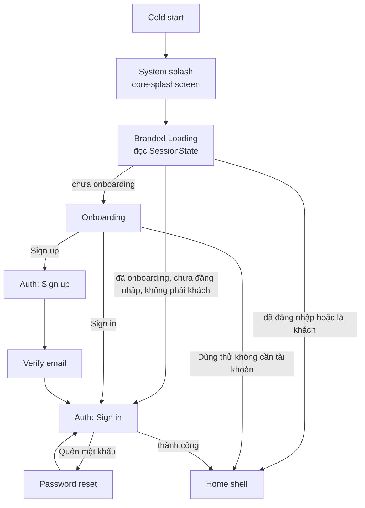

# Luồng màn hình

Thiết kế tham khảo: bộ mockup Stitch "Serene Ocean Journal" (splash, onboarding, app shell, ba biến thể Home). Mockup là **tham khảo, không phải spec**. Những điểm đã điều chỉnh so với mockup được ghi ở [design-system.md](design-system.md#10-điều-chỉnh-so-với-mockup-stitch) và [ADR-0005](adr/0005-stitch-mockups-as-reference.md).

## 1. Khởi động

| Màn hình | Destination | Back stack sau khi rời màn |
|---|---|---|
| Loading | `SplashDestination` | Bị xoá (`popUpTo(inclusive = true)`) |
| Onboarding | `OnboardingDestination` | Bị xoá khi người dùng chọn một hướng đi |
| Auth | `AuthGraph { SignIn, SignUp, VerifyEmail, ForgotPassword, ResetPassword }` | Cả graph bị xoá khi đăng nhập thành công |
| Home shell | `MainGraph` | Gốc của app |

- Cờ "đã xem onboarding" được ghi khi người dùng **chọn** một hướng đi. Nếu thoát giữa chừng thì lần sau mở lại Onboarding.
- Khách có thể mở Auth bất cứ lúc nào từ top bar hoặc từ các card mời đăng ký. Đăng nhập xong thì quay về đúng tab đang mở.

## 2. Loading

- Nền và icon trùng với system splash. Hiển thị mascot, logo, slogan và indicator ngọc trai.
- Thời gian hiển thị theo [ADR-0003](adr/0003-splash-and-branded-loading.md): kết thúc khi `SessionState` sẵn sàng, không chờ cố định.
- Mất mạng: **không chặn** người dùng. Vẫn vào app và hiện banner offline. Thanh "Prototype test" và các ghi chú kỹ thuật trong mockup **không** đưa vào app.

## 3. Onboarding

- Pager gồm 3 slide giới thiệu và 1 trang chọn cách bắt đầu.
- Slide 1–3: mascot, greeting, kicker (nhãn nhỏ viết hoa), tiêu đề, mô tả có đoạn in đậm, 2–3 tag. Mỗi slide có nút "Tiếp theo".
- Trang 4: **Đăng ký tài khoản mới** (primary), **Đã có tài khoản? Đăng nhập** (secondary), **Dùng thử không cần tài khoản** (text button).
- Nút "Bỏ qua" chuyển tới trang 4, và bị ẩn khi đang ở trang 4.
- Trên màn ≥600dp: mascot đặt bên trái, card bên phải.

## 4. Auth

| Màn | Thành phần | API |
|---|---|---|
| Sign in | Email, mật khẩu (nút hiện/ẩn), nút Đăng nhập, "Tiếp tục với Google" (đặt sau feature flag), link Quên mật khẩu, link Đăng ký | `auth/login` |
| Sign up | Họ tên, email, số điện thoại (tùy chọn), mật khẩu, xác nhận mật khẩu | `auth/register` → `challengeId` |
| Verify email | Ô OTP 6 số, nút Gửi lại có đếm ngược | `auth/verify-email`, `auth/resend-verification` |
| Forgot password | Email → OTP → mật khẩu mới (3 bước trên cùng một màn) | `password-reset/otp`, `/verify`, `/confirm` |

Mã lỗi backend được map sang chuỗi theo [api-integration.md](api-integration.md#10-bảng-mã-lỗi).

## 5. Home shell

### 5.1 Khung chung

| Thành phần | Spec |
|---|---|
| Top bar | Avatar kèm badge streak, lời chào theo buổi trong ngày, tên người dùng, nút tìm kiếm, nút thông báo. Khách thấy nút "Đăng nhập" thay cho chuông |
| Bottom bar | 5 tab: **Trang chủ · Khám phá · Luyện tập · Từ vựng · Cá nhân**. Màn ≥600dp dùng NavigationRail |
| Nội dung | Cuộn được trong `Scaffold`. Top bar và bottom bar cố định, không vẽ lại khi đổi tab |

### 5.2 Ba biến thể của tab Trang chủ

Biến thể được suy ra từ `SessionState` và dữ liệu người dùng, không phải từ một cờ cứng:

| Biến thể | Điều kiện | Nội dung | Có backend? |
|---|---|---|---|
| **Guest** | `user == null` | Hero chào mừng kèm mascot, 3 lợi ích khi đăng ký, nút Đăng ký / Đăng nhập, link "Khám phá ngay" | ✅ không cần API |
| **Registered** | Đã đăng nhập, chưa ghi danh lớp nào | Card bài kiểm tra đầu vào, card "Lớp học chính thức" (trống), "Tài nguyên miễn phí hôm nay" | ⚠️ Tài nguyên lấy từ practice-sets; placement test và nhập mã lớp chưa có API |
| **Enrolled** | Đã đăng nhập, có ít nhất một lớp | Streak, Tiếp tục học, Khoá học của tôi, Nhiệm vụ hằng ngày, banner Deadline | ❌ Chưa có API cho học viên |

Bảng chi tiết phần nào làm thật, phần nào dùng `FakeRepository` nằm ở [api-integration.md](api-integration.md#8-mockup-cần-gì-backend-có-gì). Ở bản release, các section chưa có backend sẽ bị ẩn hoặc hiện "Sắp ra mắt", không hiện số liệu giả.

### 5.3 Các tab khác

| Tab | Khách | Đã đăng nhập |
|---|---|---|
| Khám phá | Xem đề thi, practice set công khai | Như khách, thêm gợi ý theo `targetScore` |
| Luyện tập | Làm practice set, kết quả lưu local | Đồng bộ kết quả khi backend có API nộp bài |
| Từ vựng | Flashcard lưu local | Đồng bộ khi Content service có API |
| Cá nhân | Lời mời đăng nhập, cài đặt ngôn ngữ | Hồ sơ, avatar, đổi mật khẩu, đăng xuất |

## 6. Trạng thái dùng chung

| Trạng thái | Component | Mascot |
|---|---|---|
| Đang tải | `LoadingState` | `oy2_waiting` |
| Lỗi mạng | `ErrorState` | `oy2_offline` |
| Lỗi server | `ErrorState` | `oy2_error` |
| Không có dữ liệu | `EmptyState` | `oy2_empty` |
| Khách mở chức năng cần tài khoản | `ErrorState` kèm nút Đăng nhập | `oy2_locked` |
| Chức năng chưa có backend | `ComingSoonState` | `oy2_maintenance` |
